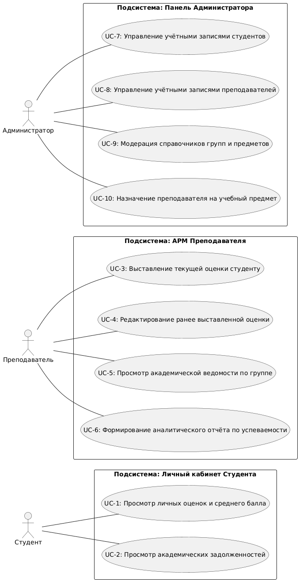
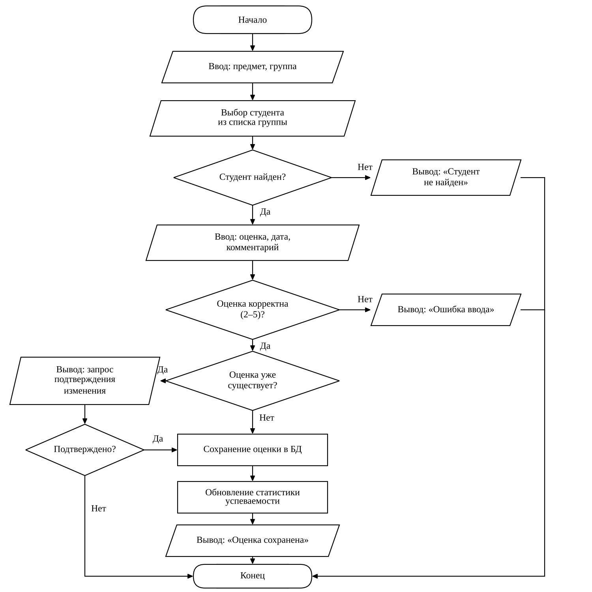
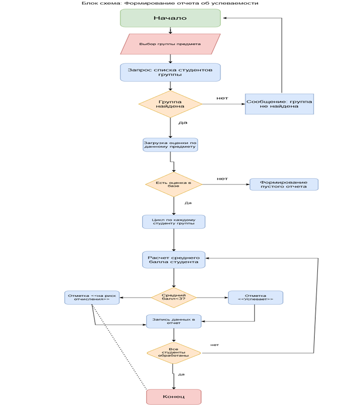
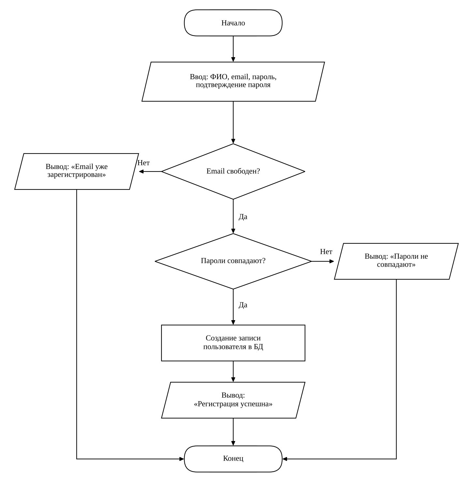

# Информационная система «Учёт оценок студентов»
Консольная система учета успеваемости студентов: преподаватели выставляют оценки, студенты смотрят средний балл и задалженности, администратор управляет справочниками. Диаграмма построена в [PlantUML](https://plantuml.com).

## 1. Постановка задачи

### 1.1 Предметная область
Разрабатываемая информационная система предназначена для учёта и контроля успеваемости студентов. Система фиксирует результаты в учебных группах и по предметам. Она позволяет отслеживать текущую успеваемость каждого студента, формировать ведомости по группам и предметам, а также выявлять студентов с академическими задолженностями.

### 1.2 Цели системы
1. Автоматизировать процесс выставления и учёта оценок.
2. Обеспечить студентам доступ к информации о своей успеваемости в любой момент.
3. Предоставить преподавателям удобный инструмент для ведения ведомостей и анализа результатов группы.
4. Позволить администратору управлять справочниками: студентами, преподавателями, группами, предметами.
5. Формировать отчёты по успеваемости для контроля качества обучения.

### 1.3 Пользователи системы и их роли
* **Студент** — авторизованный пользователь. Просматривает свои оценки по предметам, видит средний балл и информацию о задолженностях. Не может редактировать данные.
* **Преподаватель** — выставляет оценки студентам по закреплённым за ним предметам, редактирует ранее выставленные оценки, формирует ведомости по группе, просматривает статистику успеваемости.
* **Администратор** — управляет пользователями и справочниками: добавляет, изменяет и удаляет студентов, преподавателей, группы и предметы; назначает преподавателей на предметы; формирует сводные отчёты.

### 1.4 Основные функции системы

| № | Функция | Роль |
|---|---|---|
| 1 | Просмотр своих оценок и среднего балла | Студент |
| 2 | Просмотр задолженностей | Студент |
| 3 | Выставление оценки студенту | Преподаватель |
| 4 | Редактирование ранее выставленной оценки | Преподаватель |
| 5 | Просмотр ведомости по группе | Преподаватель |
| 6 | Формирование отчёта по успеваемости группы | Преподаватель |
| 7 | Управление студентами (добавление, изменение, удаление) | Администратор |
| 8 | Управление преподавателями | Администратор |
| 9 | Управление группами и предметами | Администратор |
| 10| Назначение преподавателя на предмет | Администратор |

### 1.5 Архитектура системы
Для реализации проекта выбрана классическая **трехуровневая архитектура (Layered Architecture)**:
* **Presentation Layer (Слой интерфейса):** Отвечает за взаимодействие пользователя с системой. Реализуется в виде консольного интерфейса (CLI).
* **Business Logic Layer (Слой бизнес-логики):** Реализует правила системы (проверка корректности оценок от 2 до 5, расчет среднего балла, выявление задолженностей, проверка прав доступа).
* **Data Layer (Слой данных):** Обеспечивает хранение информации в таблицах `Students`, `Teachers`, `Groups`, `Subjects`, `Grades`.

---

## 2. Моделирование процессов и взаимодействий

### 2.1 Use Case Диаграмма
Диаграмма построена как единая система без разделения на подсистемы. Для каждой роли показаны регистрация и авторизация, после авторизации пользователю доступны функции его роли.

**Регистрация и авторизация.**
Студент и преподаватель самостоятельно регистрируются в системе ( вводят ФИО, email, пароль) и затем входят в нее по логину и паролю. Учетная запись администратора создается при настройке системы, поэтому самостоятельной регистрации у администратора нет, он только авторизуется.

**Управление учетными записями.**
Это функция администратора над данными пользователей системы: 
- создание учетной записи (ФИО, email, логин, пароль, группа или кафедра);
- изменения данных учетной записи ( смена группы или кафедры, email, сброс пароля);
- удаление учетной записи ( например, при отчислении студента или увольнении преподавателей).

### 2.2 Ключевые сущности системы
* **Студент** — ФИО, номер зачётной книжки, группа, email.
* **Преподаватель** — ФИО, кафедра, email.
* **Предмет** — название, количество часов, семестр.
* **Группа** — название, курс, факультет.
* **Оценка** — студент, предмет, преподаватель, значение, дата, комментарий.

### 2.3 Блок схемы основных процессов 

**Выставление оценок преподавателем**

**Формирование отчета об успеваемости группы**

**Регистрация пользователя**
